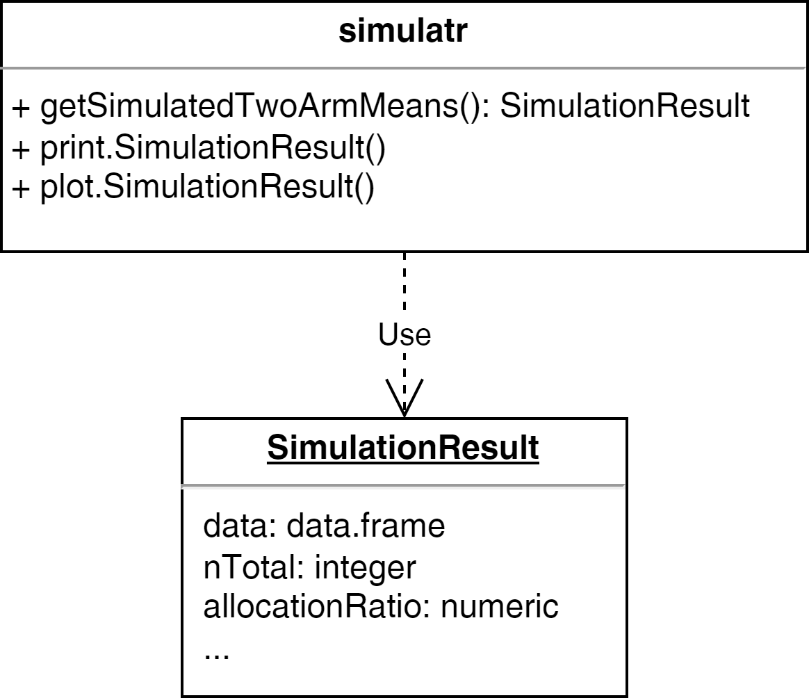
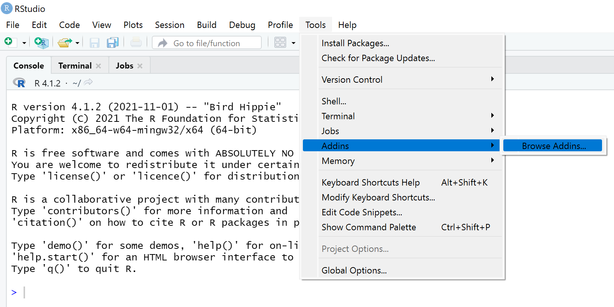
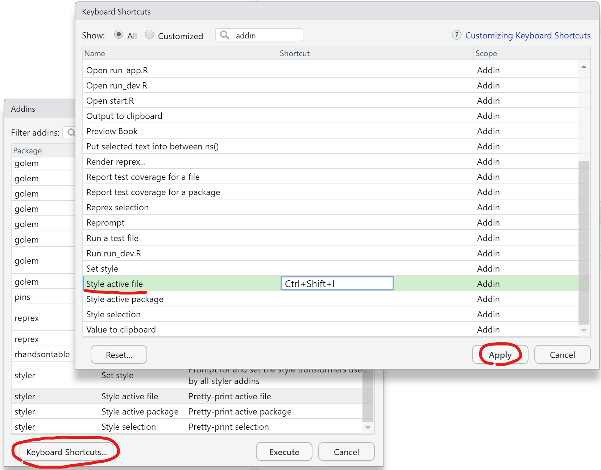

## Session 2: JnJ (online)

20 November 2026

[Download all session 2 demo code](download/session-02.zip).
Extract it, open `session-02.Rproj`, run `source("setup.R")` once,
then follow `demo.R` alongside the instructor.


# []{.yellow} Motivation

```{=html}
<!-- 
- One-off scripts, prototype functions
- R generic functions
- Design docs
- Packaging
- Professional workflow
-->
```
**From an idea to a production-grade R package**

Example scenario: in your daily work, you notice that you need certain one-off
scripts again and again.

. . .

[]{.blue} The idea of creating an R package was born
because you understood that "copy and paste" R scripts is inefficient, and on top
of that, you want to share your helpful R functions with colleagues and the
world...

::: columns
::: {.column width="50%"}
:::

::: {.column width="50%"}
[]{.blue}
:::
:::

# Professional Workflow

![[Photo CC0 by ELEVATE on
pexels.com]{.copyright}](thumbnails/workflow1.jpg){fig-align="center"}

## Typical work steps

::: incremental
::: columns
::: {.column width="55%"}
1.  Idea
2.  Concept creation
3.  Validation planning
4.  Specification:
      a. User Requirements Spec (URS), 
      b. Functional Spec (FS), and 
      c. Software Design Spec (SDS)
:::

::: {.column width="45%"}
5.  R package programming
6.  Documented verification
7.  Completion of formal validation
8.  R package release
9.  Use in production
10. Maintenance
:::
:::
:::

. . .

::: columns
::: {.column width="60%"}
:::

::: {.column width="40%"}
[]{.yellow}
[]{.yellow}
[]{.yellow}
:::
:::

# Workflow in Practice

![[Photo CC0 by Chevanon Photography on
pexels.com]{.copyright}](thumbnails/workflow2.jpg){fig-align="center"}

## Frequently Used Workflow in Practice

::: incremental
::: columns
::: {.column width="50%"}
1.  Idea
2.  R package programming
3.  Use in production
4.  Bug fixing
5.  Use in production
:::

::: {.column width="50%"}
6.  Bug fixing + Documentation
7.  Use in production
8.  Bug fixing + Further development
9.  Use in production
10. Bug fixing + ...
:::
:::
:::

. . .

[]{.yellow} Bad practice!

. . .

[]{.yellow} Why?

# Why practice good engineering?

<!-- https://www.researchgate.net/figure/Cost-Distribution-among-Software-Process-Activities-12_fig1_340280214 -->

```{r, echo = FALSE, eval = TRUE, render = TRUE, fig.cap = "Cost distribution among software process activities", fig.subcap = "[doi:10.14569/IJACSA.2020.0110375](https://dx.doi.org/10.14569/IJACSA.2020.0110375)"}
library("ggplot2") 
library("dplyr")
classes <- c("Design (12%)", "Coding (6%)", "Testing (12%)", "Maintenance (70%)")
effortData <- data.frame(
  id = 1:4,
  class = classes,
  prop = c(12, 6, 12, 70)
)

effortData$class <- factor(effortData$class, levels = classes)

effortData <- effortData %>%
  arrange(desc(class)) %>%
  mutate(lab.ypos = cumsum(prop) - 0.5*prop) %>%
  arrange(desc(id))

mycols <- c("#0073C2FF", "#EFC000FF", "#868686FF", "#CD534CFF")

ggplot(effortData, aes(x = "", y = prop, fill = class)) +
  geom_bar(width = 1, stat = "identity", color = "white") +
  coord_polar("y", start = -32) +
  geom_text(aes(y = lab.ypos, label = prop), color = "white")+
  scale_fill_manual(values = mycols) + 
  labs(fill = "Activity") +
  theme_void()
```

## Why practice good engineering?

```{r, echo = FALSE, eval = TRUE, render = TRUE, fig.cap = "Origin of errors in system development", fig.subcap = "[Boehm, B. (1981). Software Engineering Economics. Prentice Hall.](https://dl.acm.org/doi/10.5555/539425)"}
library("ggplot2") 
library("dplyr")
classes <- c("Analysis Errors (60%)", "Design and Implementation Errors (40%)")
effortData <- data.frame(
  id = 1:2,
  class = classes,
  prop = c(60, 40)
)

effortData$class <- factor(effortData$class, levels = classes)

effortData <- effortData %>%
  arrange(desc(class)) %>%
  mutate(lab.ypos = cumsum(prop) - 0.5*prop) %>%
  arrange(desc(id))

mycols <- c("#CD534CFF", "#0073C2FF")

ggplot(effortData, aes(x = "", y = prop, fill = class)) +
  geom_bar(width = 1, stat = "identity", color = "white") +
  coord_polar("y", start = -32) +
  geom_text(aes(y = lab.ypos, label = prop), color = "white")+
  scale_fill_manual(values = mycols) + 
  labs(fill = "Activity") +
  theme_void()
```

## Why practice good engineering?

::: columns
::: {.column width="45%"}
-   Don't waste time on maintenance
-   Be faster with release on CRAN
-   Don't waste time with inefficient and buggy further development
:::

::: {.column width="55%"}
-   Fulfill regulatory requirements[^1]
-   Save refactoring time when the Proof-of-Concept (*PoC*) becomes the release version
-   You don't have to be shy any longer about inviting other developers to
    contribute to the package on [GitHub](https://github.com/)
:::
:::

[^1]: See also [Ensuring Quality](02_workflow_tests.qmd)

## Why practice good engineering?

Invest time in

-   requirements analysis,
-   software design, and
-   architecture...

. . .

... but in many cases the workflow must be workable for a single developer or a
small team.

# Workable Workflow

![[Photo CC0 by Kateryna Babaieva on
pexels.com]{.copyright}](thumbnails/workflow3.jpg){fig-align="center"}

# Suggestion for a Workable Workflow

1.  Idea
2.  Design docs
3.  R package programming
4.  Quality check (see [Ensuring Quality](02_workflow_tests.qmd))
5.  Review the result before sharing it
6.  Use in production

## Example - Step 1: Idea

Let's assume that you used some lines of code to create simulated data in
multiple projects:

```{r, echo = TRUE}
dat <- data.frame(
    group = c(rep(1, 50), rep(2, 50)),
    values = c(
        rnorm(n = 50, mean = 8, sd = 12),
        rnorm(n = 50, mean = 14, sd = 11)
    )
)
```

Idea: put the code into a package

## Example - Step 2: Design docs

1.  Describe the purpose and scope of the package
2.  Analyse and describe the requirements in clear and simple terms ("prose")

| Obligation level | Key word[^2]     | Description    |
|------------------|:-----------------|----------------|
| Duty             | must, shall      | "must have"    |
| Desire           | should           | "nice to have" |
| Intention        | may              | "optional"     |

[^2]: [Rupp, C., & SOPHISTen, die. (2009). Requirements-Engineering und
    -Management: Professionelle, iterative Anforderungsanalyse für die Praxis
    (5. Ed.). Carl Hanser Verlag GmbH & Co. KG.](https://amzn.to/3DdwiBe)
    See also: [plainlanguage.gov](https://www.plainlanguage.gov/guidelines/conversational/shall-and-must/)

## Example - Step 2: Design docs

**Purpose and Scope**

The R package *simulatr* shall enable the creation of reproducible fake data.

**Package Requirements**

*simulatr* **shall** provide a function to generate normal distributed random
data for two independent groups. The function **must** allow flexible
definition of sample size per group, mean per group, standard deviation per
group. The reproducibility of the simulated data **must** be ensured via an
optional seed. It **should** be possible to print the function result. The 
package **may** also facilitate graphical presentation of the simulated data.

## Example - Step 2: Design docs

::: columns
::: {.column width="45%"}
Useful formats / tools for design docs:

-   [R Markdown](https://rmarkdown.rstudio.com)[^3] (\*.Rmd)
-   [Quarto](https://quarto.org)^1^ (\*.qmd)
-   [Overleaf](https://www.overleaf.com)[^4]
-   [draw.io](http://draw.io)[^5]
:::

::: {.column width="55%"}
::: text-align-center
UML Diagram
:::

{fig-align="right" width="95%"}
:::
:::

[^3]: Based on
    [Markdown](https://github.com/adam-p/markdown-here/wiki/Markdown-Cheatsheet),
    the easy-to-use markup language

[^4]: The easy to use, online, collaborative LaTeX editor

[^5]: A picture is worth a thousand words

## Example - Step 3: Packaging

**R package programming**

1.  Create basic package project (see [R Packages](01_packages.qmd))
2.  C&P existing R scripts (one-off scripts, prototype functions) and
    refactor[^6] it if necessary
3.  Create R generic functions
4.  Document all functions

[^6]: See also [Ensuring Quality](02_workflow_tests.qmd)

## Example - Step 3: Packaging

One-off script as starting point:

```{r, echo = TRUE}
sim.data <- function(n1, n2, m1, m2, s1, s2) {
    data.frame(
        group = c(rep(1, n1), rep(2, n2)),
        values = c(
            rnorm(n = n1, mean = m1, sd = s1),
            rnorm(n = n2, mean = m2, sd = s2)
        )
    )
}
```

## Example - Step 3: Packaging

Refactored script:

```{r, echo = TRUE}
getSimulatedTwoArmMeans <- function(n1, n2, mean1, mean2, sd1, sd2) {
    data.frame(
        group = c(rep(1, n1), rep(2, n2)),
        values = c(
            rnorm(n = n1, mean = mean1, sd = sd1),
            rnorm(n = n2, mean = mean2, sd = sd2)
        )
    )
}
```

Almost all functions, arguments, and objects should be self-explanatory due to
their names.

## Example - Step 3: Packaging

Define that the result is a list[^7] which is defined as class[^8]:

[^7]: It's common practice to add the function arguments to the result
    $\rightarrow$ should be a list or class

[^8]: To implement generics, the result must be a class

```{r, echo = TRUE}
getSimulatedTwoArmMeans <- function(n1, n2, mean1, mean2, sd1, sd2) {
    result <- list(n1 = n1, n2 = n2, 
         mean1 = mean1, mean2 = mean2, sd1 = sd1, sd2 = sd2)
    result$data <- data.frame(
        group = c(rep(1, n1), rep(2, n2)),
        values = c(
            rnorm(n = n1, mean = mean1, sd = sd1),
            rnorm(n = n2, mean = mean2, sd = sd2)
        )
    )
    # set the class attribute
    result <- structure(result, class = "SimulationResult")
    return(result)
}
```

## Example - Step 3: Packaging

The output is impractical, e.g., we need to scroll down:

```{r, echo = TRUE}
#| code-line-numbers: false
x <- getSimulatedTwoArmMeans(n1 = 50, n2 = 50, mean1 = 5, mean2 = 7, sd1 = 3, sd2 = 4)
x
```

. . .

Solution: implement generic function `print`

## Example - Step 3: Packaging

Generic function `print`:

::: panel-tabset
## Code

```{r, echo = TRUE, eval = FALSE}
print.SimulationResult <- function(x, ...) {
    args <- list(n1 = x$n1, n2 = x$n2, 
        mean1 = x$mean1, mean2 = x$mean2, sd1 = x$sd1, sd2 = x$sd2)
    
    print(list(
        args = format(args), 
        data = dplyr::tibble(x$data)
    ), ...)
}
x
```

## Roxygen

```{r, echo = TRUE, eval = FALSE}
#' @title
#' Print Simulation Result
#'
#' @description
#' Generic function to print a `SimulationResult` object.
#'
#' @param x a \code{SimulationResult} object to print.
#' @param ... further arguments passed to or from other methods.
#' 
#' @examples
#' x <- getSimulatedTwoArmMeans(n1 = 50, n2 = 50, mean1 = 5, 
#'      mean2 = 7, sd1 = 3, sd2 = 4, seed = 123)
#' print(x)
#'
#' @export
```

## Output

```{r, echo = FALSE}
#| style: font-size:0.8em!important;
print.SimulationResult <- function(x, ...) {
    args <- list(n1 = x$n1, n2 = x$n2, 
        mean1 = x$mean1, mean2 = x$mean2, sd1 = x$sd1, sd2 = x$sd2)
    
    print(list(
        args = format(args), 
        data = dplyr::tibble(x$data)
    ), ...)
}
x
```
:::

# License information

- Creators (initial authors): 
  Friedrich Pahlke [`r fontawesome::fa("github")`](https://github.com/fpahlke/) [`r fontawesome::fa("linkedin")`](https://www.linkedin.com/in/pahlke/), Andrew Bean 
  [`r fontawesome::fa("github")`](https://github.com/andrew-bean) 
  [`r fontawesome::fa("linkedin")`](https://www.linkedin.com/in/andrew-bean-83539116/)
- In the current version, changes were done by (later authors): 
  


# Apply clean code rules

{fig-align="center"}

## Why is clean code important?

-   **Maintainability**: The code is readable and understandable and has a reduced complexity, i.e., it's easier to fix bugs
-   **Extensibility**: The architecture is simpler, cleaner, and more expressive, i.e., it's easier to extend the capabilities and the risk of introducing bugs is reduced
-   **Performance**: The code often runs faster, uses less memory, or is easier to optimize

## Example: clean code rules - step by step

This script breaks all common clean code rules:

```{r, echo = TRUE}
# fmt: skip
y=function(x){
  s1=0
  for(v1 in x){s1=s1+v1}
  m1=s1/length(x)
  i=ceiling(length(x)/2)
  if(length(x) %% 2 == 0){i=c(i,i+1)}
  s2=0
  for(v2 in i){s2=s2+x[v2]}
  m2=s2/length(i)
  c(m1,m2)
}
y(c(1:7, 100))
```

. . .

We now refactor it by applying clean code rules...

## Example: CCR#1

::: columns
::: {.column width="50%"}
```{r, echo = TRUE}
# fmt: skip
y=function(x){
  s1=0
  for(v1 in x){s1=s1+v1}
  m1=s1/length(x)
  i=ceiling(length(x)/2)
  if(length(x) %% 2 == 0){i=c(i,i+1)}
  s2=0
  for(v2 in i){s2=s2+x[v2]}
  m2=s2/length(i)
  c(m1,m2)
}
y(c(1:7, 100))
```
:::

::: {.column width="50%"}
CCR#1 **Naming**: Are the names of the variables, functions, and classes
descriptive and meaningful?
:::
:::

## Example: CCR#1

```{r, echo = TRUE, eval = FALSE}
# fmt: skip
getMeanAndMedian=function(x){
    sum1=0
    for(value in x){sum1=sum1+value}
    meanValue=sum1/length(x)
    centerIndices=ceiling(length(x)/2)
    if(length(x) %% 2 == 0){
        centerIndices=c(centerIndices,centerIndices+1)
    }
    sum2=0
    for(centerIndex in centerIndices){sum2=sum2+x[centerIndex]}
    medianValue=sum2/length(centerIndices)
    c(meanValue,medianValue)
}
```

CCR#1 **Naming** []{.green}

CCR#2 **Formatting**: Are indentation, spacing, and bracketing consistent, i.e.,
is the code easy to read []{.red}

## Example: CCR#2

::: columns
::: {.column width="68%"}
```{r, echo = TRUE, eval = FALSE}
#| style: font-size:0.95em!important;
getMeanAndMedian <- function(x) {
    sum1 <- 0
    for (value in x) {
        sum1 <- sum1 + value
    }
    meanValue <- sum1 / length(x)
    centerIndices <- ceiling(length(x) / 2)
    if (length(x) %% 2 == 0) {
        centerIndices <- c(
          centerIndices, centerIndices + 1)
    }
    sum2 <- 0
    for (centerIndex in centerIndices) {
        sum2 <- sum2 + x[centerIndex]
    }
    medianValue <- sum2 / length(centerIndices)
    c(meanValue, medianValue)
}
```
:::

::: {.column width="32%"}
CCR#2 **Formatting** []{.green}

CCR#3 **Simplicity**: Did you keep the code as simple and straightforward as possible, i.e., did you avoid unnecessary complexity
[]{.red}
:::
:::

## Example: CCR#3

Note:

-   From the **Simplicity** rule also follows that large source files should be split into multiple files
-   General guideline: keeping the number of lines to less than 1,000 lines per file can help maintain code readability and manageability

## Example: CCR#3

```{r, echo = TRUE, eval = FALSE}
#| code-line-numbers: "2,7"
getMeanAndMedian <- function(x) {
    meanValue <- sum(x) / length(x)
    centerIndices <- ceiling(length(x) / 2)
    if (length(x) %% 2 == 0) {
        centerIndices <- c(centerIndices, centerIndices + 1)
    }
    medianValue <- sum(x[centerIndices]) / length(centerIndices)
    c(meanValue, medianValue)
}
```

CCR#3 **Simplicity** []{.green}

CCR#4 **Single Responsibility Principle (SRP)**: does each function have only a single, well-defined purpose []{.red}

## Example: CCR#4

```{r, echo = TRUE, eval = TRUE}
getMean <- function(x) {
    sum(x) / length(x)
}

isLengthAnEvenNumber <- function(x) {
    length(x) %% 2 == 0
}

getMedian <- function(x) {
    centerIndices <- ceiling(length(x) / 2)
    if (isLengthAnEvenNumber(x)) {
        centerIndices <- c(centerIndices, centerIndices + 1)
    }
    sum(x[centerIndices]) / length(centerIndices)
}
```

CCR#4 **Single Responsibility Principle (SRP)**
[]{.green}

CCR#5 **Don't Repeat Yourself (DRY)**: Did you avoid duplication of code, either by reusing existing code or creating functions
[]{.red}

## Example: CCR#5

::: clean-code-rule
CCR#5: DRY
:::

Suppose you have a code block that performs the same calculation multiple times:

```{r, echo = TRUE}
result1 <- 2 * 3 + 4
result2 <- 2 * 5 + 4
result3 <- 2 * 7 + 4
```

Create a function to encapsulate this calculation and reuse it multiple times:

```{r, echo = TRUE}
calculate <- function(x) {
  2 * x + 4
}

result1 <- calculate(3)
result2 <- calculate(5)
result3 <- calculate(7)
```

## Example: CCR#5

```{r, echo = TRUE, eval = FALSE}
#| code-line-numbers: "14"
getMean <- function(x) {
    sum(x) / length(x)
}

isLengthAnEvenNumber <- function(x) {
    length(x) %% 2 == 0
}

getMedian <- function(x) {
    centerIndices <- ceiling(length(x) / 2)
    if (isLengthAnEvenNumber(x)) {
        centerIndices <- c(centerIndices, centerIndices + 1)
    }
    getMean(x[centerIndices])
}
```

CCR#5 **Don't Repeat Yourself (DRY)** []{.green}

CCR#6 **Comments**: Did you use comments to explain the purpose of code blocks and to clarify complex logic []{.red}

## Example: CCR#6

::: columns
::: {.column width="60%"}
```{r, echo = TRUE, eval = FALSE}
#| code-line-numbers: "1,6,7,12"
#| style: font-size:0.9em!important;
# returns the mean of x
getMean <- function(x) {
    sum(x) / length(x)
}

# returns TRUE if the length of x is
# an even number; FALSE otherwise
isLengthAnEvenNumber <- function(x) {
    length(x) %% 2 == 0
}

# returns the median of x
getMedian <- function(x) {
    centerIndices <- ceiling(length(x) / 2)
    if (isLengthAnEvenNumber(x)) {
        centerIndices <- c(centerIndices,
             centerIndices + 1)
    }
    getMean(x[centerIndices])
}
```
:::

::: {.column width="40%"}
CCR#6 **Comments** []{.green}

CCR#7 **Error Handling**: Did you include error handling code to gracefully handle exceptions and unexpected situations
[]{.red}

```{r, echo = TRUE, eval = FALSE}
#| code-line-numbers: false
getMean(c("a", "b", "c"))
```

[Error in sum(x) : invalid 'type' (character) of argument]{.red-small}
:::
:::

## Example: CCR#7

```{r, echo = TRUE, eval = FALSE}
#| code-line-numbers: "3,8,13"
#| style: font-size:0.9em!important;
#' returns the mean of x
getMean <- function(x) {
    checkmate::assertNumeric(x)
    sum(x) / length(x)
}
#' returns TRUE if the length of x is an even number; FALSE otherwise
isLengthAnEvenNumber <- function(x) {
    checkmate::assertVector(x)
    length(x) %% 2 == 0
}
#' returns the median of x
getMedian <- function(x) {
    checkmate::assertNumeric(x)
    centerIndices <- ceiling(length(x) / 2)
    if (isLengthAnEvenNumber(x)) {
        centerIndices <- c(centerIndices, centerIndices + 1)
    }
    getMean(x[centerIndices])
}
```

CCR#7 **Error Handling** []{.green}

## Summary of clean code rules

1.  **Naming**: Use descriptive and meaningful names for variables, functions, and classes
2.  **Formatting**: Adhere to consistent indentation, spacing, and bracketing to make the code easy to read
3.  **Simplicity**: Keep the code as simple and straightforward as possible, avoiding unnecessary complexity
4.  **Single Responsibility Principle (SRP)**: Each function should have a single, well-defined purpose
5.  **Don't Repeat Yourself (DRY)**: Avoid duplication of code, either by reusing existing code or creating functions

## Summary of clean code rules

6.  **Comments**: Use comments to explain the purpose of code blocks and to clarify complex logic
7.  **Error Handling**: Include error handling code to gracefully handle exceptions and unexpected situations
8.  []{.blue} **Test-Driven Development (TDD)**: Write tests for your code to ensure it behaves as expected and to catch bugs early
9.  **Refactoring**: Regularly refactor your code to keep it clean, readable, and maintainable
10. []{.blue} **Code Review**: Have other team members review your code to catch potential issues and improve its quality

## How to apply clean code rules?

Recommended quality workflow for R packages:

-   Follow the naming and styling guidelines (#1, #2)
-   Continuously write tests and optimize the code coverage with help of tools (#7, #8)
-   Document the package and functions (#6)
-   Regularly refactor your code (#1 - #7, #9)
-   Publish your code on [GitHub](https://github.com) and invite colleagues to contribute (#10)

# Package testing

::: clean-code-rule
CCR#8: TDD
:::

{fig-align="center"}

## Verification vs validation

::: columns
::: {.column width="50%"}
**Verification**:\
Are we building the product right?

-   The product meets a set of specified requirements
-   Activities: reviews, inspections, and testing
-   Goal: ensure that the product has been designed and implemented correctly
:::

::: {.column width="50%"}
**Validation**:\
Are we building the right product?

-   Evaluate the product during or at the end of the development process
-   Show that the product meet the specified requirements
-   Goal: confirm that the product is fit for its intended purpose\
    $\rightarrow$ Refers back to the user's needs
:::
:::

## What are unit tests?

-   Automated tests
-   Record the expected output of a function using code
-   Check individual units of code (functions or methods) for correctness
-   Typically written by developers as part of the software development process
-   Typically run automatically as part of a CI/CD pipeline
-   Can be run before committing code changes

## Why are unit tests important?

::: clean-code-rule
CCR#8: TDD
:::

-   Help to ensure that individual units of code are working correctly
-   Ensure that changes to the codebase do not break existing functionality
-   Express the desired behavior in a way that a human can understand
-   Help to identify and fix bugs early on in the development process
-   Save time and resources by catching issues before they become more difficult and costly to fix

::: info-block
::: columns
::: {.column width="20%"}
[]{.yellow}
:::

::: {.column width="80%"}
Unit tests help to increase the reliability and maintainability of the code
:::
:::
:::

## What other important test types exist?

-   **Integration Testing**: Test if different functions or scripts work together as expected
-   **Performance Testing**: Analyze the performance of the implemented functions and check whether they meet the requirements (UR/UX)
-   **Snapshot Testing**: Record the results in a separate human-readable file and compare it to the output during the test; useful for large/complex outputs and binary formats like plots

# Testing in practice

{fig-align="center"}

## How to realize testing with R?

R package [testthat](https://cran.r-project.org/package=testthat)

-   Popular testing framework for R that is easy to learn and use
-   Unit testing, integration testing, and [snapshot testing](https://cran.r-project.org/web/packages/testthat/vignettes/snapshotting.html) supported
-   Also performance testing, e.g., with help of [microbenchmark](https://cran.r-project.org/package=microbenchmark) package

**Example**: unit test passed

```{r, echo = TRUE}
library(testthat)
expect_equal(getMean(c(1, 3, 2)), 2)
```

**Example**: unit test failed

```{r, echo = TRUE, eval = FALSE}
expect_equal(getMean(c(1, 3, 2, NA)), 2)
expect_equal(getMedian(c(1, 3, 2)), 2)
```

::: red-small
Error: getMean(c(1, 3, 2, NA)) not equal to 2.
Error: getMedian(c(1, 3, 2)) not equal to 2.
:::

## Investigating failed tests

```{r, echo = TRUE, eval = TRUE}
#| code-line-numbers: "2,4,9,12,14,15-19"
#| style: font-size:0.9em!important;
#' returns the mean of x
getMean <- function(x, na.rm = TRUE) {
    checkmate::assertNumeric(x)
    sum(x, na.rm = na.rm) / length(x[!is.na(x)])
}
#' returns TRUE if the length of x is an even number; FALSE otherwise
isLengthAnEvenNumber <- function(x) {
    checkmate::assertVector(x)
    length(x[!is.na(x)]) %% 2 == 0
}
#' returns the median of x
getMedian <- function(x, na.rm = TRUE) {
    checkmate::assertNumeric(x)
    centerIndices <- ceiling(length(x[!is.na(x)]) / 2)
    if (anyNA(x) & !na.rm){
        centerIndices <- NA_real_
    } else if (isLengthAnEvenNumber(x)) {
        centerIndices <- c(centerIndices, centerIndices + 1)
    }
    getMean(sort(x)[centerIndices])
}
```

## Re-evaluate tests

```{r, echo = TRUE, eval = TRUE}
expect_equal(getMedian(c(1, 3, 2)), 2)
expect_equal(getMedian(c(1, 3, 2, NA), na.rm = FALSE), NA_real_)
expect_equal(getMean(c(1, 3, 2, NA)), 2)
expect_equal(getMean(c(1, 3, 2, NA), na.rm = FALSE), NA_real_)
```

# Code style

::: clean-code-rule
CCR#2: Formatting
:::

{fig-align="center"}

## Why is code style important?

::: clean-code-rule
CCR#2: Formatting
:::

-   Make the code more readable, maintainable, and consistent
-   Make it easier for others to understand and contribute to the codebase
-   Adhering to a consistent code style can reduce the number of errors and make debugging simpler
-   "Good coding style is like correct punctuation: you can manage without it, butitsuremakesthingseasiertoread." ([The tidyverse style guide](https://style.tidyverse.org))

## How to optimize the code styling?

Two popular R packages support the [tidyverse style guide](https://style.tidyverse.org):

-   [styler](https://styler.r-lib.org): interactively restyle selected text, files, or entire projects:
    -   [style_text](https://styler.r-lib.org/reference/style_text.html)
    -   [style_file](https://styler.r-lib.org/reference/style_file.html)
    -   [style_pkg](https://styler.r-lib.org/reference/style_pkg.html)
-   [lintr](https://github.com/jimhester/lintr): perform automated checks to confirm that you conform to the style guide
-   [air](https://posit-dev.github.io/air/) : an R formatter that ensures whitespace, newlines, punctuation conform to a set of rules and standards

The [devtools](https://devtools.r-lib.org) function [spell_check](https://devtools.r-lib.org/reference/spell_check.html) runs a spell check on text fields in the package description file, manual pages, and optionally vignettes.

## Code styler in RStudio

How to link the [styler](https://styler.r-lib.org)[^10] package to a keyboard shortcut:

::: panel-tabset
## Browse addins

{fig-align="center" width="70%"}

## Set keyboard shortcut

{fig-align="right" width="52%"}
:::

[^10]: If not available, install it first

```{=html}
<!--
-   types, type safety,
-   spelling,
-->
```
# Live demo: session 2

Download and extract [session-02.zip](download/session-02.zip), open
`session-02.Rproj`, and run `source("setup.R")` once, then `source("demo.R")`.
All code is complete; participants can follow the instructor on their laptop.

Compare the before/after refactoring and run the supplied unit tests.

# References

-   Cotton, R. (2017). Testing R Code (Illustrated Edition).\
    Taylor & Francis Inc. \[[Book](https://amzn.to/3Bk6elt)\]
-   Martin, R. (2008). Clean Code: A Handbook of Agile Software Craftsmanship
    (1st Edition). Prentice Hall. \[[Book](https://amzn.to/3IKuSS4)\]
-   Vaughan, D. & Henry, L. Air, an extremely fast R formatter.    \[[Blog](https://www.tidyverse.org/blog/2025/02/air/#installing-air)]


# License information {.smaller}

- Creators (initial authors):
  Friedrich Pahlke [`r fontawesome::fa("github")`](https://github.com/fpahlke/) [`r fontawesome::fa("linkedin")`](https://www.linkedin.com/in/pahlke/),
  Andrew Bean [`r fontawesome::fa("github")`](https://github.com/andrew-bean) [`r fontawesome::fa("linkedin")`](https://www.linkedin.com/in/andrew-bean-83539116/)


