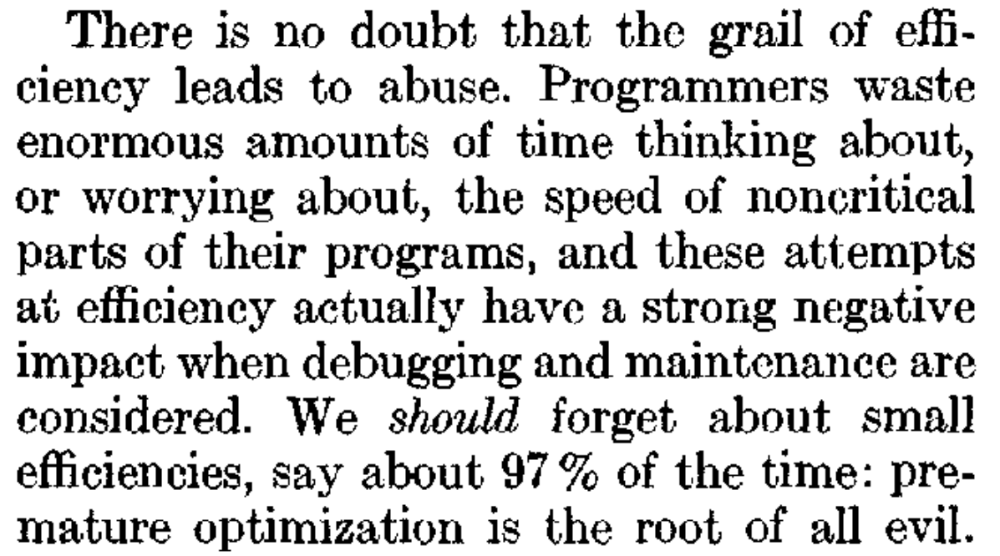
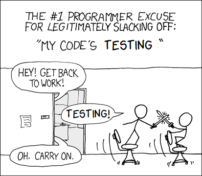
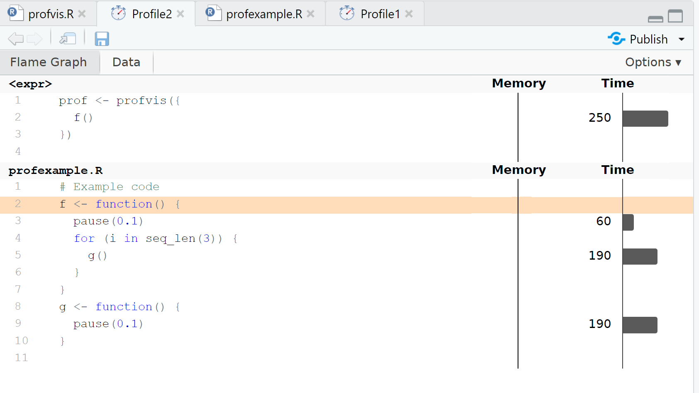
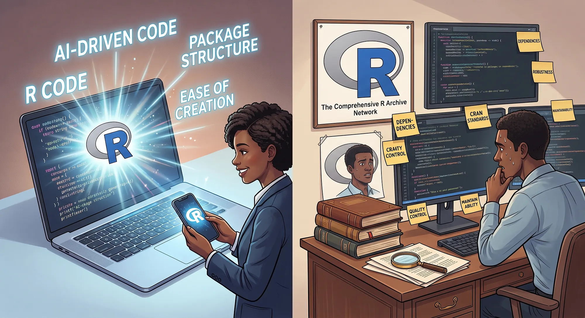
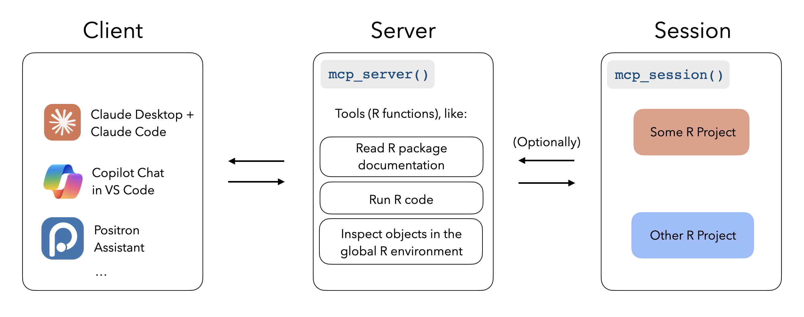

## Acknowledgments

This section is adapted from slides by Lukas A. Widmer and Michael Mayer, which they prepared and released under the CC BY 4.0 license, see their course [Go fastR – how to make R code fast(er) and run it on high performance compute (HPC) clusters](https://luwidmer.github.io/fastR-website/materials.html).

Thanks a lot Lukas and Michael!

# Introduction

## A Word of Wisdom



[@knuth1974structured, p. 268]

## Setting the right priorities

1. The code needs to be correct, i.e. calculate correct results as expected. → **Tests**, **Debugging**
1. If it is correct, but too slow, then find out which calculations and why they are too slow. → **Profiling**
1. Once you identified the slow parts, optimize those. 
→ **Code optimization**
1. If executing the code on your laptop is still too slow → consider running it instead on a high performance cluster (**HPC**), see slides from Lukas and Michael

## Tests: see previous [section](03_tests_shiny.qmd)



(modified from @xkcd, [No. 303](https://xkcd.com/303/))

## Debugging: A few pointers

1. Post-hoc `traceback()` after code fails, to show the call stack and see how the error came about.
1. Setting `debug(myfun)` for the problematic function `myfun` and then run the code to step through its execution.
1. Inject `browser()` calls into problematic code to add "breakpoints" for interactive execution and inspection.
1. Setting `options(error = recover)` and then running the problematic code allows you to jump into the call stack and inspect. (Undo with `options(error = NULL)`)

## Debugging: Some RStudio specifics

Let's have a look at RStudio IDE specific details. 

- The "Debug" menu can be useful to explore the options.
- Editor breakpoints: Can add with click to the left of line number and gives "red dot".
- Click on "Source" to run the script and enter debug mode.
- "Debug" > "On Error" > "Break in Code" again lets you jump into the code on error.
- Debugging in Rmarkdown documents can be tricky, either proceed chunk by chunk, or try `sink()`

See [Posit website](https://support.posit.co/hc/en-us/articles/205612627-Debugging-with-the-RStudio-IDE) for details.

# Profiling

## Profiling: Definition

> In software engineering, profiling ("program profiling", "software profiling") is a form of dynamic program analysis that measures, for example, the space (memory) or time complexity of a program, the usage of particular instructions, or the frequency and duration of function calls. Most commonly, profiling information serves to aid program optimization, and more specifically, performance engineering.

([Wikipedia](https://en.wikipedia.org/wiki/Profiling_(computer_programming)))

## Profiling: Example code

```{r}
#| eval: TRUE
#| echo: TRUE
f <- function() {
    profvis::pause(0.1)
    for (i in seq_len(3)) {
        g()
    }
}
g <- function() {
    profvis::pause(0.1)
}
```

## Profiling: Let's identify the bottlenecks!

In R there are a couple of basic functions for profiling:

- `system.time()`
- `Rprof`: 
  1. start with `Rprof()`
  1. execute the code
  1. stop with `Rprof(NULL)`
  1. summarize with `summaryRprof()`

See e.g. @peng2016, chapter 19, for details.

## Profiling: Classic `Rprof` output

```{r}
#| eval: TRUE
#| echo: TRUE
Rprof()
f()
Rprof(NULL)
summaryRprof()
```

## Profiling: Getting visual

We can use the more modern [`profvis`](https://rstudio.github.io/profvis) R package for visualizing where R spends its time during code execution.

```{r}
#| eval: TRUE
#| echo: TRUE
library(profvis)
source("examples/optimization/profexample.R") # Such that the flame graph includes code lines.
prof <- profvis({
    f()
})
print(prof)
```

## Profiling: `profvis` output



# Code optimization

## Code optimization: Explore alternatives

- If the slow function is from another package, search for a faster one
- Runtime complexity (runtime as a function of data size) of different algorithms can be
wildly different - some work well on small data but take forever on large data
- Few examples:
  - For wrangling data frames, consider [`duckplyr`](https://duckdblabs.github.io/duckplyr/) and [`polars`](https://rpolars.github.io/) as alternatives to [`dplyr`](https://dplyr.tidyverse.org/)
  - To read and write CSV data, consider [`vroom`](https://vroom.r-lib.org/) instead of base R
  - To read and write objects from and to disk, consider [`qs`](https://cran.r-project.org/package=qs) instead of base R `readRDS`, `saveRDS`

## Code optimization: DRY on data frames

- Remember: DRY (Don't Repeat Yourself)
- Data frames are expensive, i.e. take a lot of time.
- Some examples:
  - Only create data frames, if really necessary. 
    - Bad: `if(nrow(filter(x, condition)) > 0)`
    - Good: `if(any(condition))`
  - Assemble a data frame only once, not iteratively.
  - When subsetting a data frame and working with a column, first extract the column and then subset.

## Code optimization: Reuse, don't copy

Avoid making unintended copies of objects.

```{r}
#| eval: FALSE
#| echo: TRUE
# Bad:
result <- c()
for (i in 1:1000) result <- c(result, fun(i))
# Good:
result <- numeric(1000)
for (i in 1:1000) result[i] <- fun(i)
# Better:
result <- sapply(seq_len(1000), fun)
```

Other examples:

- Create a `data.frame` once from complete column vectors, rather than `rbind()` it iteratively.
- Subsetting a matrix or `data.frame` will create a copy, so use it consciously or better work with columns.

## Code optimization: Vectorize where possible

- Avoiding for loops does not help much anymore.
- However, using specialized vectorized functions (implemented in compiled code) helps:
  - Base R: `rowSums()`, `colSums()`, `rowMeans()`, `colMeans()`
  - [`matrixStats`](https://github.com/HenrikBengtsson/matrixStats): many! `anyMissing()`, `colQuantiles()`, `rowMax()`, etc.
  - [`collapse`](https://sebkrantz.github.io/collapse/): `fmean()`, `TRA()`, `GRP()`, ...

## Code optimization: Still too slow?

> "R is a language optimized for human performance, not computer performance"

(Hadley Wickham, New York R Conference, 2018)

## Code optimization: Shift to C++ with `Rcpp`

Writing and using C++ code in your R package is not easy.

But it is not too difficult with [`Rcpp`](https://dirk.eddelbuettel.com/code/rcpp.html) by @Eddelbuettel2011.

- Starting point: `Rcpp::Rcpp.package.skeleton()` 
- Use [`RcppArmadillo`](https://dirk.eddelbuettel.com/code/rcpp.armadillo.html) for linear algebra
- Hadley Wickham's chapter [Rewriting R code in C++](https://adv-r.hadley.nz/rcpp.html)

Note: Adding C++ code to your package will in many cases increase the maintenance effort significantly.

## References

::: {#refs}
:::

# Live demo: session 4

Download and extract [session-04.zip](download/session-04.zip), open
`session-04.Rproj`, and run `source("setup.R")` once, then `source("demo.R")`.
All code is complete; participants can follow the instructor on their laptop.

Compare equivalent slow and vectorized implementations; profile the slow version and review the prepared AI change.

# License Information

- Creators (initial authors): 
  Lukas A. Widmer and Michael Mayer, see their course [Go fastR – how to make R code fast(er) and run it on high performance compute (HPC) clusters](https://luwidmer.github.io/fastR-website/materials.html)
- In the current version, changes were done by (later author):
  Daniel Sabanes Bove [`r fontawesome::fa("github")`](https://github.com/danielinteractive/) [`r fontawesome::fa("linkedin")`](https://www.linkedin.com/in/danielsabanesbove/)


## AI makes packages easier to write

{height="330"}

More generated code makes design, documentation, and review even more valuable.

[Graphic: Pierre DeBois, *AI Made R Packages Easy to Write. But Did It Make Packages in CRAN Better?*, DataDrivenInvestor, 23 September 2026](https://medium.datadriveninvestor.com/ai-made-r-packages-easy-to-write-but-did-it-make-packages-in-cran-better-2569bd217e13){.small}

::: notes
Use the graphic to open a discussion: what makes a package useful and trustworthy?
The article raises concerns about documentation; do not infer a causal effect of AI from the illustration.
The graphic is third-party content and is excluded from the course's CC BY-SA license.
:::

## 2025 vs. 2026

| Disappointment mid-2025 | Productive use in 2026 |
| --- | --- |
| Bad at translating code (e.g. R to Julia) | Translates code well between e.g. SAS and R |
| Bad at mathematics, e.g. inverse functions | Can solve difficult math problems |
| Bad at writing tests | Draft tests, run them, and investigate failures |
| Bad at slide generation | Create and revise slides with visual feedback |
| Made up literature references | Can reliably find literature references |


::: notes
This is a retrospective on my own experience, not a guarantee for every task or model.
For R-to-Julia translation, check missing values, indexing, types, and numerical tolerances.
For an inverse, substitute back into the original function and check the domain.
For literature, open the paper and verify authors, DOI, and the claim it supports.

**All of these are now possible with current AI tools.** 
Tool access and iterative feedback have changed the experience substantially
But success still needs checking!
:::

## Keep the engineering workflow

**Design → Plan → Implement in steps → Check → Review**

1. Explain the user need, interface, constraints, and acceptance criteria
2. Ask the assistant to inspect the project and propose a plan
3. Implement one small, reviewable change at a time
4. Run examples, tests, and package checks; inspect the results
5. Review the diff and update documentation before committing

[Hadley Wickham's Tidy design principles](https://tidydesign.substack.com/) provide useful reading for designing APIs that humans and assistants can understand.

::: notes
Example prompt: “Read the design vignette and existing tests. Propose a plan for adding a missing-value option without changing existing defaults. Wait for my review of the plan before implementing.”
Discuss where a human decision is needed: the API, statistical assumptions, acceptance criteria, and final review.
:::

## Choose an IDE that fits your work

| IDE | Useful AI integration |
| --- | --- |
| [VS Code](https://code.visualstudio.com/docs/copilot/overview) | GitHub Copilot for inline/tab completion and chat; extensions for [Claude Code](https://code.claude.com/docs/en/vs-code) and [Codex](https://developers.openai.com/codex/ide/) |
| [Positron](https://positron.posit.co/assistant.html) | Posit's AI integration, **Posit Assistant**, with context from your R session, objects, plots, and console history |

- Tab completion helps with a local edit; an agent can work across files and run checks
- Start with a small task and inspect the changes and tool output
- Choose approved providers and share only data and code you are allowed to send

::: notes
Posit Assistant is the current name in the Positron documentation (October 2026).
Participants can continue using RStudio for the package live demos; switching IDE is optional.
Accounts, available models, and costs depend on the chosen provider and setup.
:::

## Instructions for your project

[AGENTS.md](https://agents.md/) gives compatible coding agents shared project context. Put it at the repository root; use scoped instructions where needed.

Keep instructions short, accurate, and version controlled. Check how your assistant discovers them.

Example:

```markdown
# Working on this R package

- Read DESCRIPTION, the design vignette, and CONTRIBUTING.md first.
- Keep public function signatures and defaults stable unless requested.
- Edit roxygen source; regenerate Rd and NAMESPACE with devtools::document().
- Add tests for changed behavior; run devtools::test() and devtools::check().
- Update vignettes and NEWS.md for user-visible changes.
- Explain mathematical changes and benchmark performance claims.
- Report the changed files, check results, and unresolved questions.
```

::: notes
AGENTS.md gives project-wide conventions; a skill gives task-specific guidance; a prompt gives the immediate task.
Additional examples: tests/AGENTS.md can describe reference data and tolerances; src/AGENTS.md can explain compiled-code conventions.
Support and discovery rules vary across assistants. Instructions do not replace permissions or sandbox controls.
:::

## Give the assistant skills

- A `SKILL.md` packages instructions for a particular kind of task
- Explore [posit-dev/skills](https://github.com/posit-dev/skills)
    - Use [r-package-development](https://github.com/posit-dev/skills/blob/main/r-lib/r-package-development/SKILL.md) for R package conventions and development guidance
    - Use [critical-code-reviewer](https://github.com/posit-dev/skills/tree/main/posit-dev/critical-code-reviewer) to request a critical review with concrete findings
- Install using your assistant's supported mechanism, then check that the relevant skill is loaded

Skills supply reusable guidance; project documentation supplies the facts about **your** package.

::: notes
Read a skill before installing it. Check its assumptions and commands against your project.
Ask: “Use the R package development skill for this change, then use the critical code reviewer skill to review the diff. Report each finding with its location and a suggested fix.”
Loading and activation differ between tools; linking a file in a prompt does not necessarily install a skill.
:::

## Keep documentation and code in sync

**Example from our `mmrm` work:** use the mathematical description to identify a faster algorithm, then implement it in code.

- Start with the current [mathematical documentation](https://openpharma.github.io/mmrm/main/articles/algorithm.html), assumptions, and notation
- Ask for an optimization proposal and review the derivation
- Implement in steps; compare with the existing implementation and benchmark
- Update the math description, code, tests, and relevant release notes together

::: notes
This is the instructor's experience supplied for the course, not a claim that the linked vignette documents a particular AI-assisted change or measured speedup.
For a numerical algorithm, compare estimates, covariance matrices, likelihoods, convergence, and edge cases as appropriate. Report both correctness evidence and benchmark conditions.
Do not treat the optimized implementation as the sole source of expected test values.
:::


## Very Important

{fig-align="center"}

## Important: Review the result, including tests

- Does the implementation meet the design and preserve the public API?
- Do tests check independent expected results, boundaries, and failure cases?
- Are examples runnable and documentation consistent with the code?
- Are dependencies and external references real and necessary?
- Have you read the diff and the actual check output?

Use a fresh review pass; fix the findings and rerun affected checks.
AI review can be very helpful for larger diffs (but ideally you want small diffs).

::: notes
An assistant can write code and tests that agree with the same misunderstanding. Use a hand-calculated example or a separately trusted implementation where possible.
Ask the reviewer to identify risks and missing evidence, rather than simply asking “Is this good?”. A second AI review complements human review.
:::

## Model Context Protocol

[Model Context Protocol (MCP)](https://modelcontextprotocol.io/) is an open protocol that gives AI applications a standard way to connect with external systems.

- An MCP **server** advertises capabilities to an AI application's MCP **client**
- Those capabilities can include **tools** (actions), **resources** (context or data), and reusable **prompts**
- The model can request a capability; the client executes it and returns the result to the conversation
- Servers may be local or remote, so access controls and the data exposed still matter

::: notes
MCP standardizes the connection, not the model's judgement. The client controls which servers are available and should show or enforce appropriate permissions before a tool has side effects.
The next slide applies this pattern to an R session and package documentation.
:::

## R as an MCP server




## Use tool connections deliberately

- Give an assistant only the tools and data needed for the task.
- Review proposed actions before allowing writes or external side effects.
- Keep credentials out of source code and prompts.
- Verify tool outputs with reproducible local checks.

## Live demo: review one prepared AI change

- Read `ai/brief.md`, `ai/project-instructions.md`, and `ai/proposed-change.diff` in the session 4 download.
- Compare `ai/before.R` and `ai/after.R`, including documentation and tests.
- Run `demo.R` to verify the result locally. Discuss the review in `ai/review.md`.
- An instructor may demonstrate an assistant; participants need no AI account or API key.

## Credits and license {.smaller}

- Chapter author: [Daniel Sabanés Bové](https://github.com/danielinteractive/), Zurich 2026
- Graphic: [Pierre DeBois, DataDrivenInvestor, 23 September 2026](https://medium.datadriveninvestor.com/ai-made-r-packages-easy-to-write-but-did-it-make-packages-in-cran-better-2569bd217e13). Supplied for this course; third-party content excluded from the course's CC BY-SA license. No additional reuse license is asserted.
- Technical sources are linked on the relevant slides; further reading: [Tidy design principles](https://tidydesign.substack.com/)


